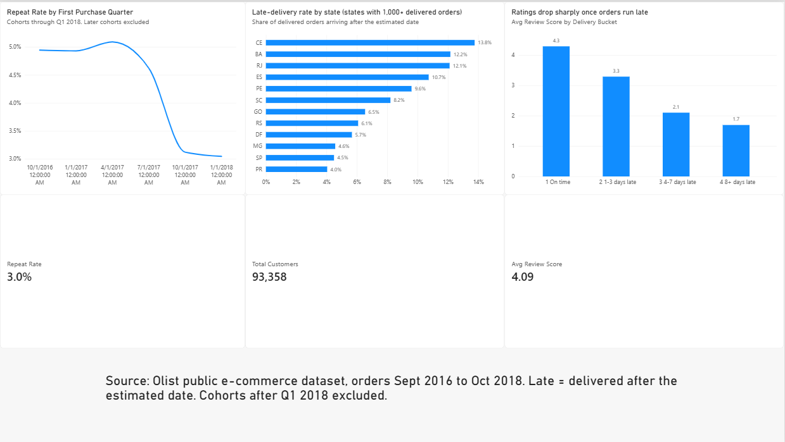

# Olist: Late Deliveries and Repeat Purchases



Power BI dashboard: [powerbi/olist_dashboard.pbix](powerbi/olist_dashboard.pbix)

**Question:** Do customers come back, and what drives low ratings on Olist's marketplace?

**Key finding:** Late deliveries cut average ratings from 4.29 to 2.27 stars. Repeat purchases are rare (3.0% of customers), so delivery reliability is the main lever.

Read the full write-up in [case_study.md](case_study.md).

## Data
Brazilian E-Commerce Public Dataset by Olist (Kaggle). Place the nine CSV files in a folder called `olist_data/`.

## Reproduce
```bash
pip install duckdb pandas scipy
python python/load_and_check.py   # loads CSVs into olist.duckdb and runs data checks
python python/build_views.py      # builds deduplicated reviews and orders_enriched view
python python/analysis.py         # repeat rates, cohorts, late-delivery test
```
The SQL definitions are in `sql/orders_enriched.sql`.

## Limitations
Observational data, not an experiment. Covers 2016–2018. See the case study for details.

## Power BI
Run `python python/export_powerbi.py` to write `powerbi/orders_enriched.csv`, `powerbi/customers_cohorts.csv`, and `powerbi/state_late_rates.csv`. These files are excluded from git because they are large and regenerate from the raw data.
